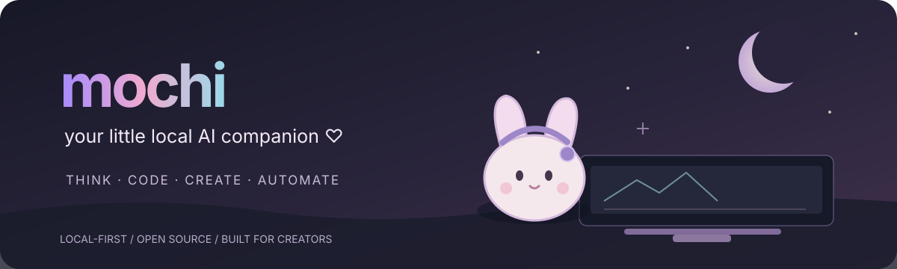
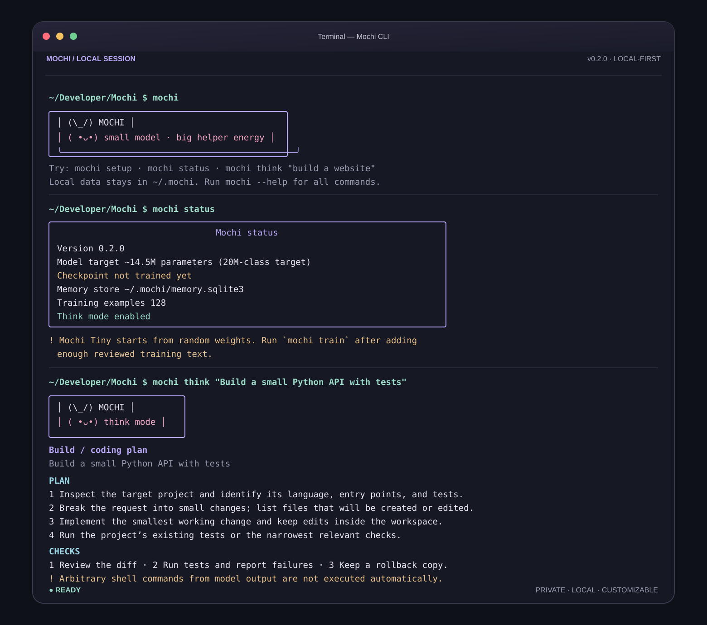

<div align="center">
  

  # Mochi 🐰

  **Your little local AI companion for coding, creating, and automating.**

  [](LICENSE)
  
  
  

  `Think` · `Code` · `Create in 3D` · `Automate` · `Personalize`
</div>

---

> **Project status:** Mochi is an experimental, local-first assistant. The CLI, project utilities, procedural Blender tooling, memory/configuration layer, and training prototype are under active development. See [known limitations](docs/KNOWN_LIMITATIONS.md) before relying on any integration.

## 🌙 What is Mochi?

Mochi is a small, customizable AI companion built for developers and creative workflows. It combines a friendly, minimal command-line interface with local memory, a tiny trainable Transformer experiment, coding utilities, procedural Blender tools, and optional VTuber/FlyBrain bridges.

The 14.5M-parameter model is an educational prototype—not a GPT-scale foundation model. Mochi's practical capabilities come from the surrounding tools and reviewed workflows, not from parameter count alone.

## ✨ Features

| Area | What is available | Status |
|---|---|---|
| 🧠 Think mode | Visible task plans, checks, and risk notes | Experimental |
| 🧩 Local model | 14.5M-parameter decoder-only Transformer prototype | Experimental |
| 💻 Coding agent | Detects 30+ languages/formats, inspects projects, scaffolds common starters, and runs recognized tests with approval | Prototype |
| 🧊 Blender | Procedural `.blend` scenes and PNG previews from validated recipes; five starter presets | Prototype |
| 🎨 Design | Editable SVG title cards and simple layouts | Prototype |
| 📚 Research | Local document/source search utilities | Early prototype |
| ⚙️ Automation | Reviewed, allow-listed workflows | Prototype |
| 💾 Memory | Local SQLite memory and user-controlled reset | Prototype |
| 🎭 VTube Studio | Local WebSocket API integration hooks | Experimental; live app test needed |
| 🪰 FlyBrain | Token-protected local event bridge example | Simulator hook-up still required |

See the [feature matrix](docs/FEATURES.md) and [known limitations](docs/KNOWN_LIMITATIONS.md).

## 👀 CLI preview

This preview shows the output from running Mochi's welcome, status, and Think commands in a fresh temporary data directory. No trained checkpoint is implied.

<p align="center">
  
</p>

## ⬇️ Download and run

### Option A — Download the source archive

Download the self-contained v0.2.0 source archive:

[**⬇ Download Mochi v0.2.0 source (.tar.xz)**](downloads/Mochi-v0.2.0-source.tar.xz)

Verify its checksum, extract it, and run the installer:

```bash
cd ~/Downloads
shasum -a 256 -c Mochi-v0.2.0-source.tar.xz.sha256
tar -xJf Mochi-v0.2.0-source.tar.xz
cd Mochi
chmod +x scripts/install_macos.sh
./scripts/install_macos.sh
```

The macOS installer creates a Python 3.11 virtual environment, installs the lightweight CLI dependencies, initializes `~/.mochi`, and checks the local setup. Training (PyTorch) and VTube Studio dependencies are optional and are not installed by default.

### Option B — Clone the repository

```bash
git clone https://github.com/ghostfacethegreat/Mochi-v0.2.0.git
cd Mochi-v0.2.0
```

The repository hosts the project hub, docs, and downloadable source archive. Use Option A for the complete runnable v0.2.0 source bundle.

### Launch Mochi

After installation:

```bash
cd ~/Downloads/Mochi
source .venv/bin/activate
mochi
```

Useful first commands:

```bash
mochi doctor
mochi status
mochi --help
mochi think "Build a small Python API with tests"
mochi agent languages
mochi blender presets
```

### Optional extras

Install training or VTube Studio dependencies only when you need them:

```bash
source .venv/bin/activate
pip install -e '.[train]'   # PyTorch + NumPy for local training
pip install -e '.[vtube]'   # VTube Studio WebSocket + keyring support
```

Blender is a separate application: install it from <https://www.blender.org/download/> and check it with `mochi blender doctor`.

## 🧑‍💻 Coding agent

```bash
mochi agent languages
mochi agent inspect ~/Developer/MyProject
mochi agent plan "Build a small Python API"
mochi agent scaffold my-rust-app --language rust --destination ~/Developer
mochi agent test ~/Developer/my-rust-app
```

Language detection is broader than starter-template and test-runner coverage. Test commands are shown before execution because repository-defined scripts can run code.

## 🧊 Blender creation

```bash
mochi blender doctor
mochi blender presets
mochi blender create --preset studio --output ~/Developer/MochiArt/studio.blend
mochi blender spec-template --output ./my-scene.json
mochi blender create --spec ./my-scene.json --output ./my-scene.blend
```

The current system creates procedural primitives and blockouts. It is not yet text-to-mesh generative modeling, advanced sculpting, or automatic character rigging.

## 🧠 Train and personalize

```bash
mochi customize
mochi learn add "How do I write safer Python?" \
  "Validate inputs, handle errors, and test failure paths." --category coding
mochi train --steps 100 --batch-size 1 --context 128
mochi chat --think
```

Training examples are added explicitly. Mochi does not silently train on private conversations. Install the `[train]` extra first. The small parameter count does not imply GPT-scale reasoning ability.

## 🔒 Privacy and safety

- User state is stored under `~/.mochi`, separate from the app installation.
- Memory, persona, and training data can be reset independently.
- Training examples are curated explicitly.
- Mochi does not blindly execute arbitrary model-generated shell commands.
- Project test commands and automation actions require review/approval.
- Blender scenes are generated from validated recipes rather than arbitrary model-written Python.

Read [Safety and privacy](docs/SAFETY_AND_PRIVACY.md).

## 🗺️ Roadmap

- [x] Minimal CLI, local configuration, and memory foundation
- [x] Small from-scratch Transformer prototype
- [x] Project inspection, language detection, and starter scaffolds
- [x] Procedural Blender scene recipes and presets
- [x] Reviewed automation workflow prototype
- [ ] Complete clean macOS install test on Apple Silicon
- [ ] Publish reproducible M1 Pro model memory, latency, and training metrics
- [ ] Complete live VTube Studio end-to-end test
- [ ] Connect FlyBrain simulator events to its bridge
- [ ] Improve coding evaluation and creative workflows

See [roadmap](docs/ROADMAP.md).

## 🤝 Contributing

Issues, reproducible bug reports, documentation improvements, and small pull requests are welcome. Please read [CONTRIBUTING.md](CONTRIBUTING.md) and use the issue templates. Include hardware, OS, Python, model configuration, and exact commands with performance reports.

## 📜 License

Mochi project code is released under the [MIT License](LICENSE), unless a subdirectory or third-party component states otherwise. Model weights, user-created training data, Blender assets, Live2D models, and dependencies may have separate licenses.

---

<div align="center">
  Made with care, tea, and a little bunny energy. ♡<br />
  <sub>Local-first · Experimental · Built in the open</sub>
</div>
